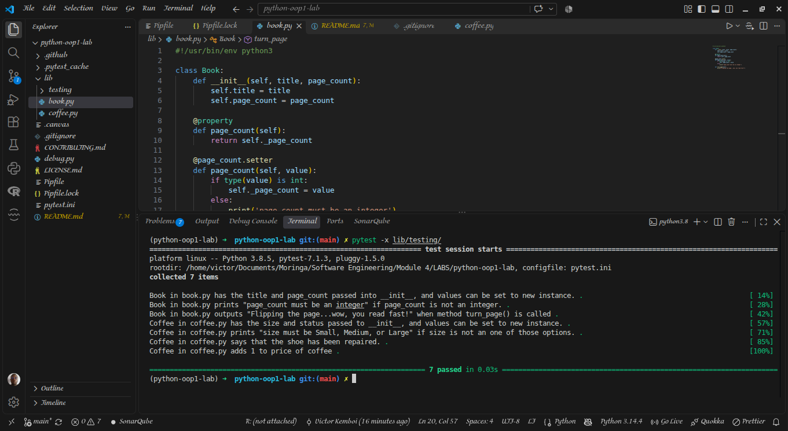

# Object-Oriented Programming Lab: Bookstore

## Description

This project is a Python-based simulation of a bookstore, built to demonstrate core Object-Oriented Programming (OOP) principles. It features two distinct classes—`Book` and `Coffee`—that utilize Python properties (`@property` and `@setter`) to enforce data validation and encapsulation. 

The application ensures that a book's page count is an integer and that a coffee's size is restricted to specific options, preventing invalid data from being stored.

## Features

**Book Class**:

    *   Accepts `title` and `page_count`.
    *   Validates that `page_count` is an integer (prints an error if not).
    *   Includes a `turn_page()` method that simulates reading.
**Coffee Class**:

    *   Accepts `size` and `price`.
    *   Validates that `size` is strictly "Small", "Medium", or "Large".
    *   Includes a `tip()` method that increases the price by $1 and prints a gratitude message.

## Requirements

Python 3.8 or higher

`pytest` for running the test suite

## Installation & Setup

To get this project running on your local machine, follow these steps:

1. **Clone the repository:**

```bash
git clone https://github.com/Victor-Mufasa/python-oop1-lab.git
cd python-oop1-lab
```

## Set up the environment (using Pipenv):

```bash
pipenv install
pipenv shell
```

(Alternatively, if you are using a standard virtual environment: python -m venv venv && source venv/bin/activate && pip install pytest)

## Usage & Testing

This lab is test-driven. To verify that the classes are working correctly, run the test suite from the root directory:

```bash
pytest -x testing/
```

To test a specific class, you can target the individual test files:

```bash
pytest -x testing/book_test.py
pytest -x testing/coffee_test.py
```

## Contributing

This project was completed as part of a Moringa School Object-Oriented Programming lab.

## Screenshot



## License

This project is open-source and available under the MIT License.